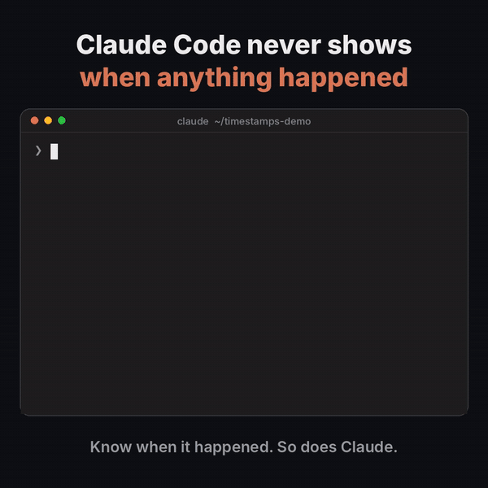
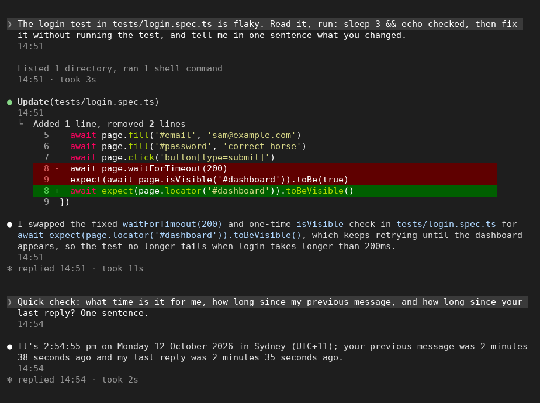
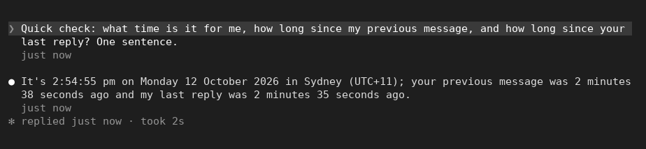
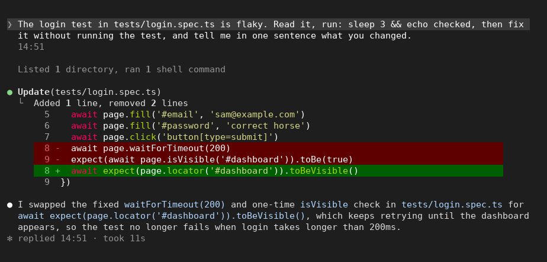
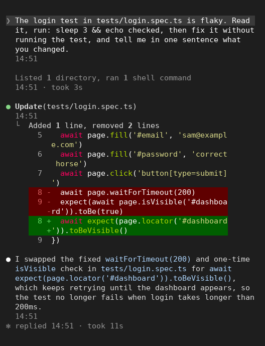

<div align="center">

# Timestamps for Claude Code

**See when everything happened. Let Claude know the time too.** 🕑

A Claude Code mod that adds the time to your conversation, the way it would look if Claude Code had it built in.<br>
A dim time under every message, reply, tool call and command, `replied 14:07 · took 1m 48s` on the line that closes each turn, and a short timestamp with each prompt so Claude knows what time it is and how long it's been.

[](LICENSE)
[](#install)
[](#install)



</div>

## How it works

**1. Use Claude Code as usual.** You don't do anything.

**2. Everything in the conversation gets a dim time underneath.** Your messages, Claude's replies, tool calls (with how long they took), command output, and notifications. `14:05` for today, or `Mon 9 Oct, 14:05` for an older day. Prefer it quieter? `/timestamps mine` keeps times under your own messages only.

**3. Each turn's closing line shows when Claude replied and how long it took.** Claude Code's own `✻ Baked for 1m 48s` becomes `✻ replied 14:07 · took 1m 48s`.

**4. Claude knows the time.** Each prompt you send carries one short timestamp that only Claude reads (see [What Claude sees](#what-claude-sees)), so Claude knows the date, the time, your time zone, and how long it's been since you last wrote. Your words are never changed.



Claude Code still draws its own rows. The mod only adds a dim line under them, so text wraps exactly as before, in a narrow terminal or a wide one.

```text
❯ fix the flaky login test
  14:05

  Read 1 file, ran 1 shell command
  14:05 · took 3s

● Found it. The test waits on a fixed 200 ms timeout…
  14:07

✻ replied 14:07 · took 1m 48s
```

## Why I built it

Claude Code shows no times at all. When you scroll back through a long session, you can't tell what you asked an hour ago from what you asked a minute ago, or which step took twenty minutes. It's one of the most asked-for features on the Claude Code issue tracker (for example [#21051](https://github.com/anthropics/claude-code/issues/21051) and [#69032](https://github.com/anthropics/claude-code/issues/69032)).

Claude doesn't know the time either. It's told the date when a session starts and nothing after, so in a session that runs past midnight, or one you come back to the next day, it can't tell how long you were away. Timestamps fixes both.

I wanted it to feel like it was always there: no extra boxes, no colours, nothing that moves your text around. Just the time, in the same dim grey Claude Code uses for its own notes.

## What it shows

| Where | What you see | With `/timestamps mine` |
|---|---|---|
| **Your message** | `14:05`, `2:05 PM` or `5m ago`. Older than today: `Mon 9 Oct, 14:05`; another year: `Mon 9 Oct 2025, 14:05`. | Same |
| **Each block of Claude's reply** | The time it was written | Nothing |
| **A tool call, or a collapsed group of calls** (`Read 2 files, ran 1 shell command`) | `14:05 · took 3s`: when it started and how long it ran | Nothing |
| **Command output** (`/cost`, `/timestamps`, …) | The time it ran | Nothing |
| **Notifications and messages from other agents** | The time they arrived | Nothing |
| **The line that closes a turn** | `✻ replied 14:07 · took 1m 48s` | Same |
| **Where nothing is drawn** (`claude -p`, the VS Code chat panel) | One line after each turn: `sent 14:05 · replied 14:07 · took 1m 48s` | Same |

A row with no recorded time shows nothing, never a guess.

| | |
|---|---|
| <br>**Relative style**: `/timestamps relative` | <br>**Quieter**: `/timestamps mine` |
| <br>**Narrow terminals**: nothing moves | |

## What Claude sees

When you send a prompt, Claude reads your words exactly as you typed them, and then one short note, added by the mod. The first prompt of a session:

```text
Timestamp (timestamps plugin, not the user): Mon 2026-10-12 15:13:17 +11:00, Australia/Sydney.
```

After that, just the time, and how long it's been when it's been a while:

```text
Timestamp (timestamps plugin, not the user): Mon 2026-10-12 17:21:03 +11:00. 3h 16m after the user's previous message.
```

- **It's small.** About 22 tokens per prompt (about 35 on the first, or after a long gap). Twenty prompts cost about 450 tokens.
- **It says what it is.** It's labelled as a timestamp from this plugin, not your words, so Claude doesn't answer it or act on it. Asked, Claude says the plugin added it.
- **It can't be misread.** The date is written `2026-10-12` with the weekday, the time in 24-hour form with seconds, and the UTC offset.
- **Your time zone's name** (`Australia/Sydney`) is sent once per session, on the first prompt, and again after the conversation is compacted.
- **The gap** since your previous message is added only when it's 10 minutes or more. For shorter gaps Claude can tell from the earlier notes already in the conversation.
- **Background-task notifications** get the same note.
- **Not added to** slash commands or prompts other plugins send.
- **You don't see it in the transcript.** It's sent as context beside your prompt, the way Claude Code adds its own reminders.
- **It goes where your prompt goes:** to Anthropic, under your account, as part of the conversation. It holds the time, the UTC offset, your time zone's name (once), and sometimes the gap since your previous message. Nothing else.
- **Turn it off** with the *Tell Claude the time* option (`tellClaude: false`). The times on screen keep working.

## Install

**1. Install.** In Claude Code, type this and press Enter:

```
/plugin install timestamps --marketplace paragpandyareal/claude-code-timestamps
```

If it asks to add the marketplace, answer **y**. If it asks where to install it, choose **User** (all your projects).

Or, in two steps:

```
/plugin marketplace add paragpandyareal/claude-code-timestamps
/plugin install timestamps@claude-code-timestamps
```

**2. That's it.** It starts working in the session straight away. Send a message and the time appears under it.

**Needs Claude Code v2.1.287 or later** (run `claude --version`). Nothing else to install.

If Claude Code says *userConfig options not yet set*, that's fine: every option has a default (below), and you can change them later.

## Use it

| To… | Type |
|---|---|
| Turn times off, or back on | `/timestamps` |
| Turn them on or off explicitly | `/timestamps on`, `/timestamps off` |
| `14:05` or `2:05 PM` | `/timestamps 24h`, `/timestamps 12h` |
| `14:05` or `5m ago` | `/timestamps clock`, `/timestamps relative` |
| Times on every row, or only under your messages | `/timestamps all`, `/timestamps mine` |
| Go back to your options | `/timestamps reset` |

Your choice is remembered in every session until you change it. Relative times count up once a minute; older than today, they show the date instead. `/timestamps off` hides the times on screen; to stop the note Claude reads, use the *Tell Claude the time* option.

### Options

Set them when you install, or any time with `/plugin configure timestamps@claude-code-timestamps`.

| Option | Default | What it does |
|---|---|---|
| Hour format (`format`) | `auto` | `12h`, `24h`, or `auto` to follow your computer's locale |
| Style (`style`) | `clock` | `clock` (`14:05`) or `relative` (`5m ago`) |
| Where times appear (`show`) | `everything` | `everything`, or `mine` for your own messages only |
| Show turn duration (`showDuration`) | on | Adds `took …` to the closing line and to tool calls |
| Tell Claude the time (`tellClaude`) | on | Adds the [timestamp note](#what-claude-sees) beside each prompt |
| Fill in older messages (`backfill`) | on | On `/resume` and `/branch`, reads this session's own transcript to show times for rows from before the mod loaded |

## Where times are kept

In Claude Code's plugin store on your computer (`~/.claude/plugins/store/`), one entry per session: the id of each row and its time, the time of your last prompt, and the path of that session's transcript. **No message text.** It keeps at most 5,000 rows per session, 200 sessions, 90 days and 2 MiB in all, well under the store's 4 MiB limit, and deletes the oldest first.

Times survive `/resume`, `/branch`, `/clear` (the new conversation starts fresh), compaction, restarts and two sessions running at once (each writes only its own entry).

## Limits and known issues

- **More lines on screen.** With `everything`, each reply block, tool call and command gets one more line. `/timestamps mine` goes back to times under your messages only.
- **Older rows are filled in on resume.** Rows from before the mod loaded get their times from the session's own transcript when you `/resume` or `/branch`, or when the mod reloads. If you install it partway through a session, that session's earlier rows show no time until you resume it.
- **Transcripts over 4 MB aren't read.** Claude Code lets a mod read at most 4 MB from one file. For a very long session, rows from before the mod loaded show no time. Rows recorded while the mod was running always keep theirs. Nothing is shown as an error.
- **Claude knows the time when you send a prompt,** not as each tool finishes inside a long turn. A turn that runs for an hour still has the time it started.
- **The fallback line is labelled.** Where nothing is drawn, Claude Code puts the mods' names in front of a mod's line, so it reads `timestamps: sent 14:05 · replied 14:07 · took 1m 48s`. Plain `claude -p` output is unchanged, so scripts that read it aren't affected; the line goes into the session's transcript.
- **Subagents.** A subagent's own prompts and replies aren't shown in the main conversation, so they get no time. Its tool calls get one.
- **Time zone.** Times use the time zone of the computer Claude Code runs on. Over SSH, that's the server's (set `TZ` to change it, for example `TZ=Australia/Sydney claude`). The note Claude reads uses the same zone.
- **The Desktop app** draws the times too. Its own closing line isn't Claude Code's terminal one, so there the reply time isn't shown.
- **Windows and macOS** are covered by the same code and tests, and have been tried by hand only on Linux.

## Troubleshooting

| Problem | What to do |
|---|---|
| No times appear | Run `/reload-plugins` (or restart Claude Code). Check `timestamps` is enabled in `/plugin`. Check `/timestamps` didn't turn them off: type `/timestamps on`. |
| Too many times on screen | `/timestamps mine` |
| `/timestamps` doesn't exist | Your Claude Code is older than v2.1.287. Run `claude --version` and update. |
| The times are an hour or more out | Claude Code is using your computer's (or server's) time zone. Set `TZ`, as above. |
| Older rows have no time | See *Older rows* and *Transcripts over 4 MB* above. Try `/resume` on that session. |
| Claude still doesn't seem to know the time | Check *Tell Claude the time* is on (`/plugin configure timestamps@claude-code-timestamps`). The note is read with each new prompt. |
| Something else | Open an issue (see [Support](#support)) with your Claude Code version, operating system and terminal. |

## Permissions and data

Timestamps is a Claude Code *mod*: code that runs inside Claude Code with your user account's permissions, outside Claude Code's sandbox. This is everything it does.

| It… | When | Why |
|---|---|---|
| Notes the time each row is added to the conversation: your prompts, Claude's reply blocks, tool calls and results, commands, and the turn's closing line. It reads each row's id, type and who sent it, and the ids of tool calls inside it. **Never the words.** | As each row is added | So it can show the time |
| Adds the [timestamp note](#what-claude-sees) beside your prompt, for Claude | Each time you send a prompt, unless *Tell Claude the time* is off | So Claude knows the time |
| Saves ids and times in its own entry in Claude Code's plugin store | Half a second after a change, and when a session ends | So times survive restarts and `/resume` |
| Reads this session's own transcript file, and only that file | On `/resume`, `/branch` and reloads, if *Fill in older messages* is on | To fill in times for rows from before the mod loaded |
| Draws a dim line under rows and rewrites the turn's closing line | When Claude Code draws them | To show the times |
| Adds one line after each turn | Only where nothing is drawn (`claude -p`, the VS Code chat panel) | So those users get times too |
| Deletes its own oldest entries | Five seconds after a session starts | To stay under 2 MiB |

It never makes network requests, starts no programs, writes no files, calls no model, reads no environment variables, and adds no tools to Claude. The only thing it adds to what Claude reads is the timestamp note. It has no telemetry or accounts.

### Exactly what the mod hooks, calls and reads

This section is for anyone reviewing the code, including Anthropic's directory review. Everything that touches Claude Code is in `hooks/register.ts`. You can check the list yourself: `claude plugin validate .` in a clone of this repo prints it.

**Hooks.** None of these blocks, approves or rewrites a tool call. Each passes its event on and returns what Claude Code returns, except where noted. Every hook has a `.catch` that passes the event on unchanged if anything goes wrong, so a failure shows Claude Code's normal behaviour with no time.

| Hook | What it does with what it sees |
|---|---|
| `session.start` | Registers `/timestamps`, reads its saved settings and this session's saved times, and (on a reload) fills in from the transcript it already knows |
| `classic.SessionStart` | Reads the session's id and transcript path after startup, `/clear`, `/resume`, `/branch` and compaction. On `/resume` and `/branch`, fills in from that transcript. |
| `session.end` | Saves this session's times |
| `session.append` | Notes the time of a row by its id. It reads the row's door, type, id and origin, and (for Claude's replies and tool results) the tool-call ids in it. It never reads or changes the text. |
| `prompt.submit` | **Adds one entry to the prompt's `context`: the timestamp note.** It never changes `text` (your words). Skipped for prompts other plugins send, and when *Tell Claude the time* is off. Slash commands don't pass through it. |
| `turn.complete` | For the main conversation only, and only where nothing is drawn: adds `sent … · replied … · took …` as the line after the answer. Everywhere else it returns the answer unchanged. |
| `ui.render` for `UserMessage`, `AssistantMessage`, `ToolUse`, `ToolGroup`, `CommandOutput` | Draws Claude Code's own row with one dim line under it. Rows with no known time, and (with `mine`) every row but your own messages, are left exactly as Claude Code draws them. An expanded tool group is left alone, since each call in it has its own row. |
| `ui.render` for `TurnDuration` | Replaces the text of the turn's closing line with `✻ replied … · took …` |
| `command.run` for `timestamps` only | Answers its own `/timestamps` command. It doesn't see or change other commands. |

**Calls.**

| Call | What for |
|---|---|
| `fs.read` | **Only to read the current session's own transcript file**, to fill in times for older rows. The path is the one Claude Code gives for this session, and it's read only if the file is named after this session's id (`<session id>.jsonl`). From it the mod takes only ids, row types and times. Nothing else is ever read. Turn it off with *Fill in older messages*. |
| `store.get`, `store.set`, `store.keys`, `store.delete` | Its settings and one entry per session (row ids and times), in its own store |
| `session.id`, `session.surfaces` | Which session this is, and whether the terminal or the Desktop app is drawing |
| `clock.after`, `clock.every` | Saving in the background, filling in after the hook has returned, and redrawing: once a minute in relative style, otherwise once at midnight so yesterday's rows show their date |
| `command.register`, `ui.resolve`, `ui.invalidate` | Adding `/timestamps` and drawing |

**What it writes.** Only its own entries in Claude Code's plugin store. No files.

**What it sends to Claude.** Only the timestamp note, beside each prompt you send, built from the clock, your computer's time zone and the time of your previous prompt. Never anything from a file or another message.

**Credentials.** It reads none, and no environment variables.

**The `tests/` folder** holds the automated tests, run with `claude plugin test`. Claude Code never loads them when you use the plugin.

### Notes for the directory review

| Likely finding | What the mod does |
|---|---|
| Adds context to a prompt (`prompt.submit`) | One short fixed-form line, built only from the clock, the system time zone and the previous prompt's time, labelled as a timestamp from this plugin and not the user's. Never changes the typed text; skipped for other plugins' prompts; off with one option. Shown word for word in the README. |
| Reads a file (`fs.read`) | Only this session's own transcript, by the path Claude Code hands its `SessionStart` hook, and only when the file's name is `<this session id>.jsonl`. It reads ids and times from it. Off with one option. |
| Hooks an event that can refuse (`session.append`, `classic.SessionStart`) | Observes only: notes a time and passes the row on unchanged; its `.catch` passes it on if anything fails. It never answers in place of `next`. |
| Changes a turn's answer (`turn.complete`) | Only where nothing is drawn, and only by adding a line under the answer. Claude Code never rewrites the stored answer, and plain `claude -p` output is unchanged. |
| Hooks an event that is also a call (`command.run`) | Answers only its own `/timestamps`. |
| Rewrites drawing (`ui.render`) | Keeps Claude Code's own drawing of each row and adds a line; replaces only the text of the turn's closing line. |

### Things to know
- **Times are kept on your computer**, as ids and times only, never your words. Uninstalling and the step below remove them.
- **Claude reads the timestamp note** with every prompt (about 22 tokens), and it goes to Anthropic as part of the conversation, like the date Claude Code already sends. Once a session it includes your time zone's name (for example `Australia/Sydney`). Turn it off with *Tell Claude the time*.
- **The times are when Claude Code stored each row.** For your prompt, that's the moment you pressed Enter.

## Privacy

Full policy: [Privacy policy](PRIVACY.md).

- The plugin collects nothing and sends nothing to its author or anyone else.
- It keeps row ids and times on your own computer, never message text.
- It adds one short timestamp note to each prompt for Claude (the time, the UTC offset, your time zone's name once a session, and the gap since your last message when it's long), which goes to Anthropic with your prompt. You can turn it off.

## Not in version one

- **Times on Claude's replies in the Desktop app's closing line.** The Desktop app draws its own, which a mod can't reach yet.
- **The time inside a long turn.** Claude is told the time with each prompt, not as each tool finishes.
- **Per-project settings.** Your `/timestamps` choice applies everywhere.

## Uninstall

1. Run `/plugin uninstall timestamps`.
2. Run `/plugin marketplace remove claude-code-timestamps`.
3. Optional: delete its saved times, the file starting `timestamps` in `~/.claude/plugins/store/`.

## Learn more

- [How it works](docs/HOW-IT-WORKS.md): the architecture, for anyone changing the code
- [Changelog](CHANGELOG.md)

## Support

- **Questions, bugs and ideas:** open an issue at [github.com/paragpandyareal/claude-code-timestamps/issues](https://github.com/paragpandyareal/claude-code-timestamps/issues).
- **Security problems:** report privately as [SECURITY.md](SECURITY.md) describes. You'll get a reply within 7 days.
- **Author:** [Parag Pandya](https://github.com/paragpandyareal).

## License

[MIT](LICENSE) © 2026 Parag Pandya.
